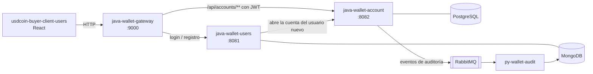

# usdcoin-buyer-client-users

[](https://github.com/josejps84/usdcoin-buyer-client-users/actions/workflows/ci.yml)

**Interfaz web** de la billetera. Permite:
- Registrarse e iniciar sesión.
- Ver las cuentas en una tabla paginada.
- Si el usuario es administrador, editar la moneda y el estado de cualquier cuenta.

Solo se comunica con el API gateway.



| Repo | Rol |
|---|---|
| [java-wallet-gateway](https://github.com/josejps84/java-wallet-gateway) | Punto de entrada único; valida el JWT y enruta |
| [java-wallet-users](https://github.com/josejps84/java-wallet-users) | Registro, login y emisión de JWT |
| [java-wallet-account](https://github.com/josejps84/java-wallet-account) | Cuentas y movimientos |
| [py-wallet-audit](https://github.com/josejps84/py-wallet-audit) | Guarda los eventos de auditoría |
| **usdcoin-buyer-client-users** | Interfaz web (este repo) |

## Stack

React 19 · Vite 8 · React Router 7 · Vitest + Testing Library · ESLint · nginx (imagen de producción).

## Pantallas

| Ruta | Pantalla | Acceso |
|---|---|---|
| `/login` | Inicio de sesión | pública |
| `/register` | Registro: identificación, nombre, correo, contraseña de 8 caracteres o más | pública |
| `/dashboard` | Tabla de cuentas: número, saldo, moneda, estado y usuario | requiere sesión |
| cualquier otra | Redirige a `/login` | — |

En el dashboard:
- **Cliente:** ve sus propias cuentas.
- **Administrador:** ve todas las cuentas y tiene un botón ✎ en cada fila para cambiar la moneda y el estado (habilitada o deshabilitada).
- **Paginación:** de 3 a 50 filas por página.

## Sesión y seguridad

- **Token:** el JWT que devuelve el login se guarda en `localStorage`.
- **Sesión en la UI:** `src/auth.js` decodifica el token para saber el email, el rol y si expiró. Esto solo decide **qué muestra** la interfaz, como el botón de editar. Los permisos reales los aplica el backend, que valida la firma del token en cada petición.
- **Peticiones:** `apiFetch` (`src/api.js`) agrega `Authorization: Bearer ...` a cada petición.
- **Sesión expirada:** si el backend responde 401 a una petición que llevaba token, la sesión expiró. Se borra el token y se vuelve al login. Un 401 sin token, como un login con la contraseña equivocada, se muestra como error normal.
- **Errores:** el backend responde con `ProblemDetail` (RFC 9457), y la interfaz muestra el campo `detail` (por ejemplo "Saldo insuficiente" o "El usuario con este email ya existe").

## Estructura

```
src/
├── main.jsx                 Entrada; monta <App />
├── App.jsx                  Rutas y protección del dashboard
├── config.js                URL del gateway desde variables de entorno
├── auth.js                  Token en localStorage y sesión decodificada
├── api.js                   apiFetch, SessionExpiredError y errorMessage
├── components/
│   ├── LoginForm.jsx
│   ├── RegisterForm.jsx
│   ├── Dashboard.jsx        Encabezado, logout y edición de cuentas (PUT /api/accounts/edit)
│   └── AccountsTable.jsx    Tabla paginada (GET /api/accounts) y panel de edición
└── test/                    Setup de Vitest y helpers (makeToken, mockFetch)
```

## Configuración

Variables de Vite, que se incrustan en el build. Ver [`.env.example`](.env.example):

| Variable | Default | Descripción |
|---|---|---|
| `VITE_API_HOST` | `http://localhost` | Host del gateway |
| `VITE_API_PORT` | `9000` | Puerto del gateway |

## Ejecutar en local

Requisitos: Node 22 o superior, y el backend corriendo (al menos el gateway, users y account).

```sh
cp .env.example .env
npm install
npm run dev        # http://localhost:5173
```

El gateway acepta por defecto peticiones desde cualquier puerto de `localhost`.

| Script | Qué hace |
|---|---|
| `npm run dev` | Servidor de desarrollo con HMR |
| `npm run build` | Build de producción en `dist/` |
| `npm run preview` | Sirve el build localmente |
| `npm run lint` | ESLint |
| `npm test` | Tests con Vitest (una corrida) |
| `npm run test:watch` | Tests en modo watch |

### Docker

```sh
docker build --build-arg VITE_API_HOST=http://localhost --build-arg VITE_API_PORT=9000 -t wallet-client .
docker run -p 8080:80 wallet-client   # http://localhost:8080
```

La imagen compila con Node y sirve los archivos estáticos con nginx, con fallback a `index.html` para las rutas de la SPA.

## Tests

`npm test` corre la suite con Vitest y Testing Library sobre jsdom:
- `auth` y `api`: sesión, headers, 401 y lectura de errores.
- `AccountsTable`: listado, paginación, sesión expirada y edición de estado.
- `Dashboard`: el cliente no ve acciones de administrador; el administrador edita.
- Formularios de login y registro, y rutas protegidas.

`fetch` se reemplaza por un mock; no hace falta el backend.

El [workflow de CI](.github/workflows/ci.yml) corre lint, tests y build en cada push a `main` y en cada pull request.
